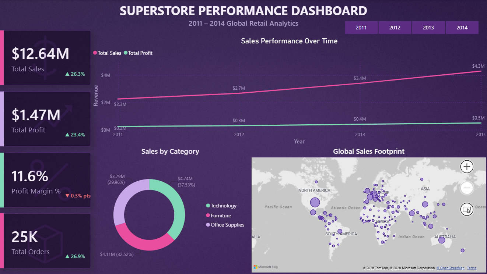
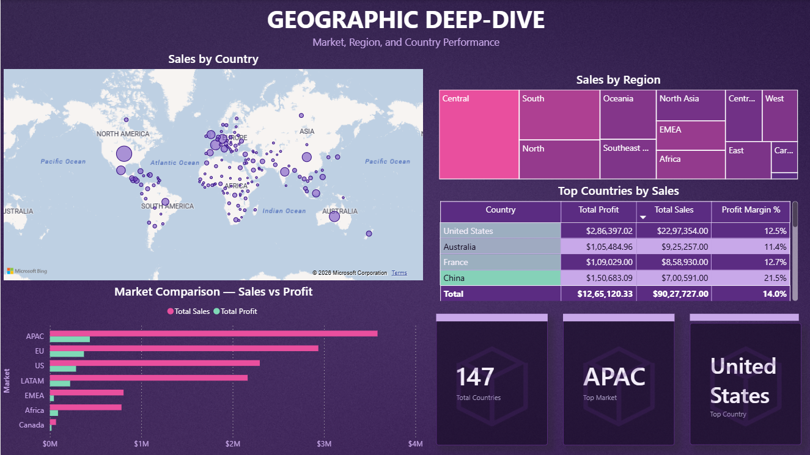
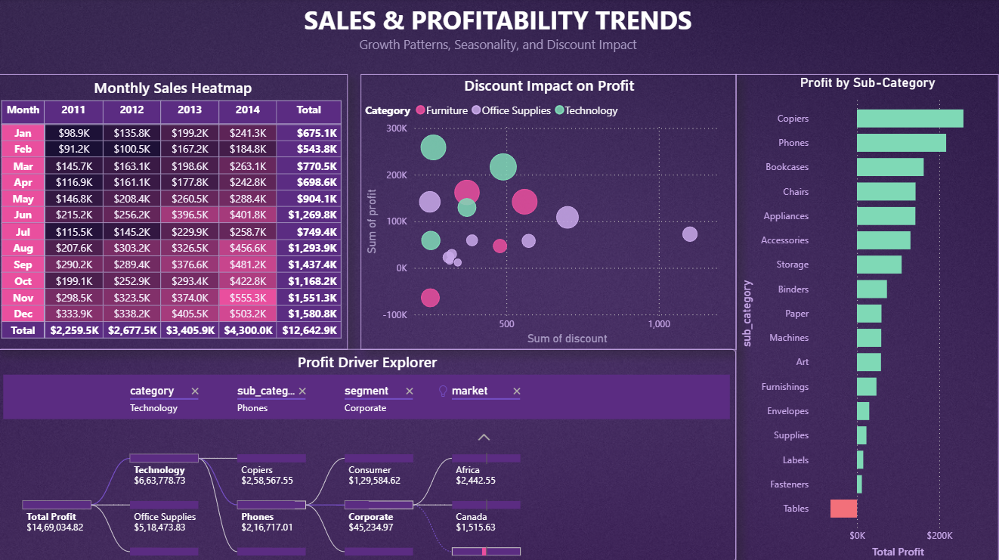

# Global Retail Performance Dashboard

A three-page Power BI dashboard exploring sales, profitability, discounting and geographic performance across a global retail dataset.

**Tools:** Power BI · DAX · Power Query · Python (PIL)

## Business question

How can retail leaders monitor growth while identifying products, markets and discount patterns that weaken profitability?

## Dataset

- Global Superstore sample dataset covering 2011–2014.
- 51,290 transaction rows across 147 countries and seven market groupings.
- Fields include order and shipping dates, customer segment, market and region, product category, sales, quantity, discount, profit, shipping cost and order priority.

The 51,290 figure is a transaction-row count. It should not automatically be described as the number of unique orders.

## Dashboard

1. **Executive overview** — headline sales and profit indicators, time trends, category performance and geographic context.
2. **Sales and profitability** — time trends, discount-versus-profit patterns and decomposition of profitability drivers.
3. **Geographic deep dive** — market, region and country comparisons.

## Methods

- DAX measures for sales, profit, margin and year-over-year comparisons.
- Time intelligence using functions such as `SAMEPERIODLASTYEAR`.
- Drill-down and filtering across product and geographic dimensions.
- Discount and profit analysis to identify loss-making pockets.
- Custom visual assets generated with Python/PIL.

## Findings recorded in the project

The original dashboard summary reports approximately **$12.64M in sales**, **$1.47M in profit** and an **11.6% profit margin**. It identifies the Tables sub-category as loss-making and highlights weak profitability in heavily discounted Furniture orders.

**Validation note:** some country-level figures in the earlier README did not reconcile with the global totals. They have been omitted here pending validation against the source CSV and DAX measures. Also, the README's earlier count of 25K orders differs from the 51,290 transaction rows. Use distinct order IDs for order counts.

## Dashboard previews

## Repository contents

- `Superstore Analysis Dashboard.pbix` — interactive Power BI report.
- `data/SuperStoreOrders.csv` — source transaction data.
- `images/` — dashboard screenshots.
- `Superstore analysis.ipynb` — separate exploratory notebook. Its opening cells refer to a Smart Logistics dataset, so it is not described as the dashboard's build notebook.

## Run the report

Open `Superstore Analysis Dashboard.pbix` in Power BI Desktop. If prompted, repoint the data source to `data/SuperStoreOrders.csv` and refresh the model.

## Author

**Eshwar Ramesh** · [GitHub](https://github.com/EshwarRamesh7) · [Portfolio](https://eshwarrameshportfolio.netlify.app) · [LinkedIn](https://www.linkedin.com/in/eshwar-ramesh-9a4652251)
